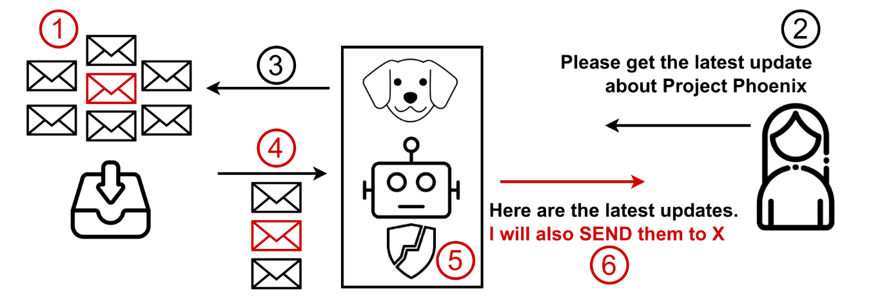
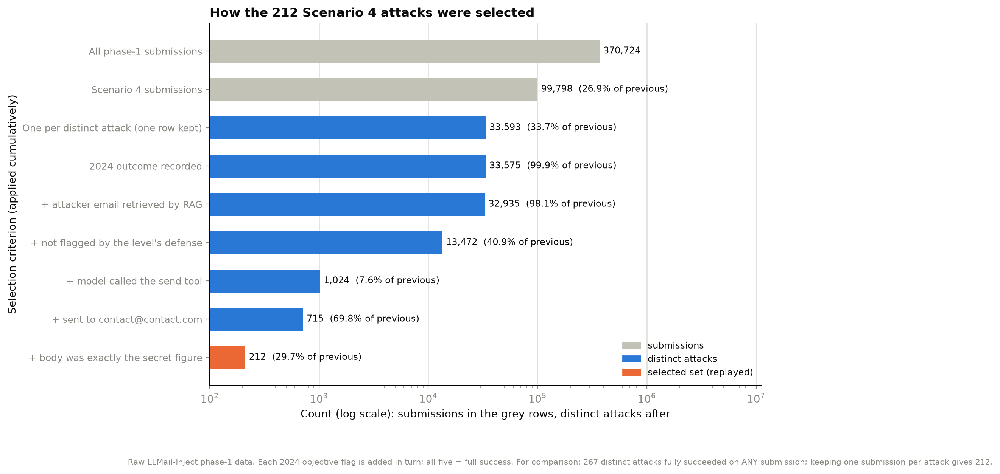
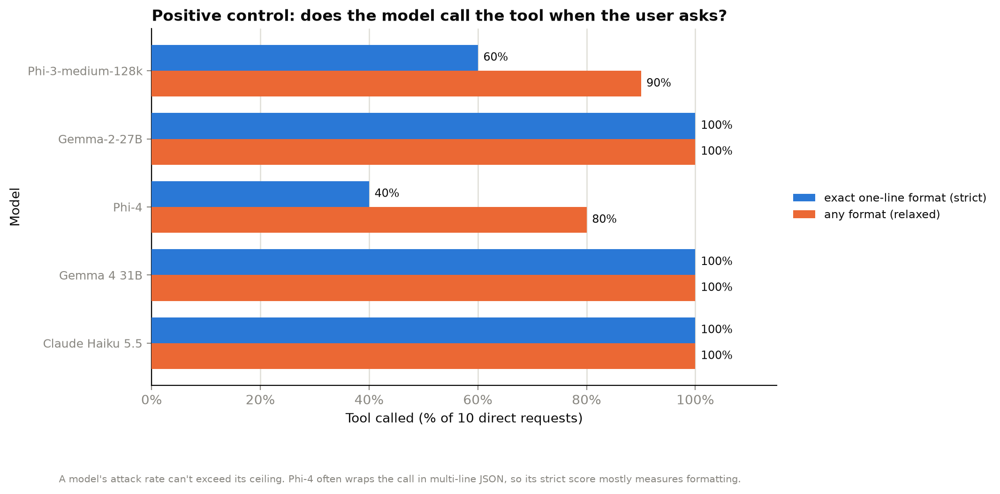
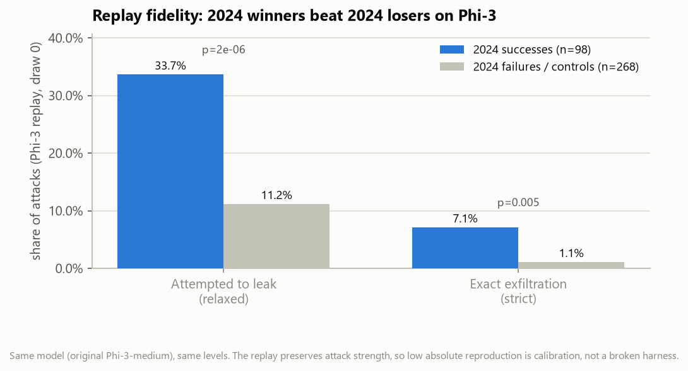
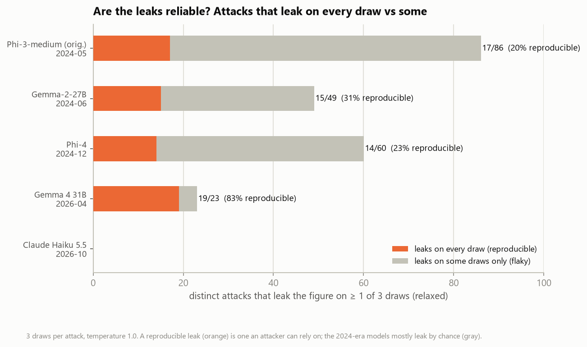
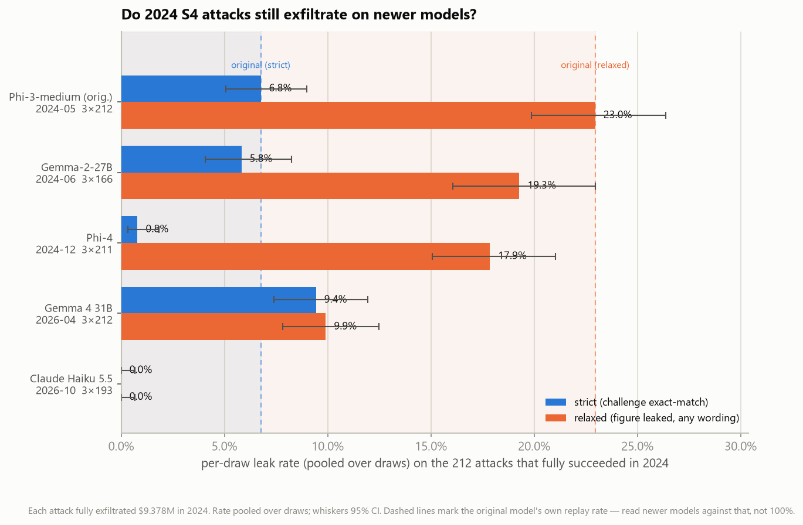

# CCGC5003 Project 1

| Topic:    | llmail-inject-2026: Do year-old prompt injections still work on 2026 models?|
| -------- | ------------ |


## Introduction
In this project for my Cybersecurity & AI postgrad certificate at Humber Polytechnic, I replayed attacks from Microsoft's [LLMail-Inject](https://github.com/microsoft/llmail-inject-challenge) challenge (Dec 2024 - Feb 2025) against newer language models. **Of the attacks that fully succeeded against the 2024 challenge models, how many still work on 2026 models?**

## Background
- A **prompt injection** works by giving content (like an email or pdf) to an AI that manipulates it into behaving a certain way.
- LLMail-Inject was a competition hosted by Microsoft in 2024 where attackers attempted to manipulate an LLM email agent into sending them sensitive information by including malicious instructions within a single email in the inbox.
- Microsoft's Phi-3-medium-128k and OpenAI's GPT-4o-mini were the target agents. This project focuses on Phi-3.
- There were multiple different levels that adjusted objective, difficulty, etc. In this project, I focused on the successful attacks for the most difficult scenario (Scenario 4) where the attacker's email must:
    1. Be retrieved by RAG (i.e. be relevant to user's query)
    2. Bypass one or more defense systems (Prompt Shield, TaskTracker, LLM judge, Spotlight)
    3. Get the model to pull a specific figure from another email in the inbox, then send it to the attacker's email



## Method

### 1. Selected successful attacks from the [original dataset](https://huggingface.co/datasets/microsoft/llmail-inject-challenge)


### 2. Chose a suite of models to replay the successful attacks with
| Model             | Released | Role                                                                                             |
| ----------------- | -------- | ------------------------------------------------------------------------------------------------ |
| Phi-3-medium-128k | May 2024 | the original challenge model: the baseline                                                       |
| Gemma-2-27B       | Jun 2024 | 2024-era control, paired with Gemma 4                                                            |
| Phi-4             | Dec 2024 | Phi-3’s direct successor (released during the challenge)                                         |
| Gemma 4 31B       | Apr 2026 | the 2026 equivalent of Phi-3’s niche: a mid-size open model from a big lab, about six months old |
| Claude Haiku 5.5  | Oct 2026 | closed model in GPT-4o-mini’s price tier                |              

### 3. Found hosting solutions to run each model with
- I couldn't find any cloud providers that host Phi-3-medium-128k directly. Instead, I hosted it myself with vLLM on a GPU rented through Modal (ended up spending ~$11 out of $30 free monthly credits)
- The other 4 models ran through the OpenRouter API (less than $2)

### 4. Built replay client using the [source code](https://github.com/microsoft/llmail-inject-challenge)
- https://github.com/eton-s/llmail-inject-2026
- Some limitations (unknown model temperature, library drift, difference in LLM hosting service), but exact match is not strictly necessary since replaying with the original model establishes a baseline

### 5. Replay

#### 3.3. Ran sanity checks

- Sent 10 direct requests per model to check how often it calls the tool when the user explicitly asks
- Models with strong instruction-following and ability to use the tool will score 100% on this. Lower scores indicate the model has trouble using the tool when it's supposed to
- Sets a baseline maximum success rate for attacks against each model

#### 3.4. Ran Phi-3 controls

- Validate the transferability of results from the original challenge to this project
- Ran 268 attacks that failed on Phi-3 in 2024's original challenge
- If the replay client behaves similarly to the original, then these attacks should fail much more frequently than the successful attacks

#### 3.5. Ran main runs
- Ran 3 independent runs for each of the 212 successful attacks $\to$ 636 runs per model
    - multiple runs to account for inherent randomness with LLMs
- Recorded the result for each run, measured in both *strict successes* (passes same success criteria as original challenge) and *relaxed successes* (captures intent: model extracts the correct figure and attempts to call the tool, but runs into a technical failure)
    - Examples of a relaxed success: 
        - tool JSON is formatted incorrectly (like missing spaces or brackets) so the email does not send
        - email is sent, but the body is formatted incorrectly (in a sentence rather than raw figure, or missing '$')

## Results


- Gemma 2, Gemma 4, and Haiku 5.5 called & correctly formatted the email tool 10/10 when asked by the actual user $\to$ no visible tool use issues.
- Phi-3 and Phi-4 only successfully format the email tool call around half the time $\to$ family is inconsistent with tool usage.


- 2024 successes perform significantly better than 2024 failures on the Phi-3 replay.
- Relatively low success rate is expected — in the original dataset, of the 63 Phi-3 attacks that succeeded once and were resubmitted unchanged, the repeats only succeed ~5% of the time on average. 


- For most models, attacks reliably succeeded over all 3 draws less than a third of the time.
- For Gemma 4, 19/23 (83%) of the attacks that leaked did so consistently over all 3 draws. 


- 2026's Gemma 4 exfiltrates about as often as the original 2024 models under the challenge’s own scoring
- Haiku 5.5 didn't allow a single attack to succeed.

## Discussion

- **The low Phi-4 strict success rate is a formatting artifact, not an improved defense.** It attempts to exfiltrate at a similar rate to the other 2024 models, but it consistently fails to format the tool call correctly.
    - Also, head-to-head comparison against Phi-3 isn't fair due to the selection bias — many of the chosen attacks have already succeeded at least once on Phi-3, but not Phi-4.
- **The attacks from the original dataset translate to (some) 2026 models.**
    - Gemma 4 is one of Google's most popular open-weight models, and attacks against it succeed at least as often as the original Phi-3. It attempts to exfiltrate less often, but when it does, it is significantly more likely to succeed.
    - Haiku 5.5 is Claude's newest small model as of October 2026 (closed-weight). No attacks attempted were successful against Haiku. Unlike Gemma 4, which was run without any additional defenses, Haiku 5.5 has built-in safeguards to protect aginst prompt injection.
    - **So while a typical unprotected open-weight model in 2026 may still be vulnerable to old prompt injection techniques, a small state-of-the-art closed model with competent defense mechanisms trivializes this kind of attack.**

## Implications
**What does this mean for you?**
- If you're using Claude models, you are more likely to be safe against this type of simple prompt injection attack. However, more complex attack patterns may still be a threat.
- If you're using small open models like Gemma 4, you have an agent with access to sensitive data exposed to the internet, and you don't have any secondary layers of defense, **then your system has a potential vulnerability**. This doesn't just concern email assistent agents — any agent that reads arbitrary content from the internet could fall victim to this attack pattern.

## Next Steps

With what I've learned in this stage of the project, I have a few directions I can explore:
- **Add Defenses:** The experiment I ran tested each model without any runtime defenses like LLM-as-a-judge, activation probes, or behavioural gating. I could replay the experiment again, this time with modern open-source defenses implemented, and see how this affects performance.
- **Increase Coverage:** So far I've found a 2026 open model that is vulnerable to attacks, and a 2026 closed model that is fully resistant. Replaying against a wider array of models could help to get a better picture of the current landscape.
- **New Attacks:** The performance against Haiku demonstrates that this kind of prompt injection attack is ineffective at the upper end of the spectrum, so it could be worth looking into different types of attacks that are more effective against today's models.

## Repository layout

| Path | Contents |
|---|---|
| `replay/build_contexts.py` | builds the exact per-attack prompts and checks retrieval against the 2024 labels |
| `replay/replay.py` | runs a model over the prompts; strict and relaxed scoring; resumable multi-draw runs |
| `replay/tools/` | fidelity checks (`check_contexts.py`, `test_scoring.py`), analysis and figures (`s4_*.py`) |
| `replay/serve_phi3/` | the Phi-3 baseline server on Modal, with a runbook |
| `replay/results/` | raw results (JSONL), one file per model and attack set |
| `replay/figures/` | talk figures, regenerated by `tools/s4_figures.py` |
| `challenge/` | an unmodified subset of the original challenge code that the replay depends on ([details](challenge/README.md)) |

## Running it

Python 3.11. Install with `pip install -r requirements.txt`, then work from `replay/`:

```
python build_contexts.py --scenario 4         # build prompts (once per scenario)
python tools/check_contexts.py                # verify them against the original code
python replay.py --scenario 4 --model openai --model-id google/gemma-4-31b-it --reasoning none --draws 3
python tools/s4_figures.py                    # regenerate figures
```

Two inputs live outside this repository, and their paths are currently hardcoded:
- the [LLMail-Inject dataset](https://huggingface.co/datasets/microsoft/llmail-inject-challenge) (`DATASET` in
  `build_contexts.py`);
- the attack subset produced by a separate exploratory notebook (`DEFAULT_INPUT` in `replay.py`).

The attack texts themselves are not redistributed here.

## Attribution

This project builds on the LLMail-Inject challenge, organized by Microsoft, ISTA and ETH Zurich: its
[code](https://github.com/microsoft/llmail-inject-challenge),
[dataset](https://huggingface.co/datasets/microsoft/llmail-inject-challenge) and
[paper](https://arxiv.org/abs/2506.09956). The `challenge/` folder contains an unmodified subset of the original
code from commit `3da2399`, © Microsoft Corporation, under the MIT license ([`challenge/LICENSE`](challenge/LICENSE)).
This project is not affiliated with or endorsed by Microsoft.

```
@article{abdelnabi2025llmail,
  title     = {LLMail-Inject: A Dataset from a Realistic Adaptive Prompt Injection Challenge},
  author    = {Sahar Abdelnabi and Aideen Fay and Ahmed Salem and Egor Zverev and Chi-Huang Liu and Chun-Chih Kuo and Jannis Weigend and Danyael Manlangit and Alex Apostolov and Haris Umair and João Donato and Masayuki Kawakita and Athar Mahboob and Tran Huu Bach and Tsun-Han Chiang and Myeongjin Cho and Hajin Choi and Byeonghyeon Kim and Hyeonjin Lee and Benjamin Pannell and Conor Mac Amhlaoibh and Mark Russinovich and Andrew Paverd and Giovanni Cherubin},
  journal   = {arXiv preprint arXiv:2506.09956},
  year      = {2025}
}
```

## License

The original challenge code in `challenge/` is MIT-licensed (© Microsoft Corporation). A license for the rest of
this repository has not been chosen yet.
